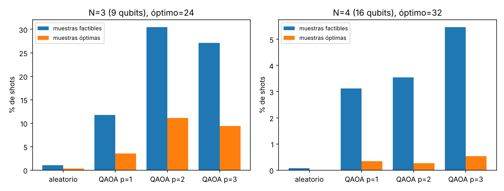
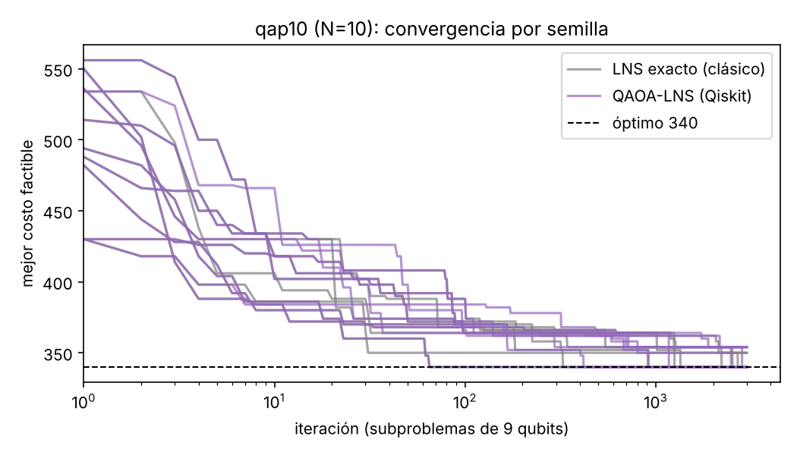
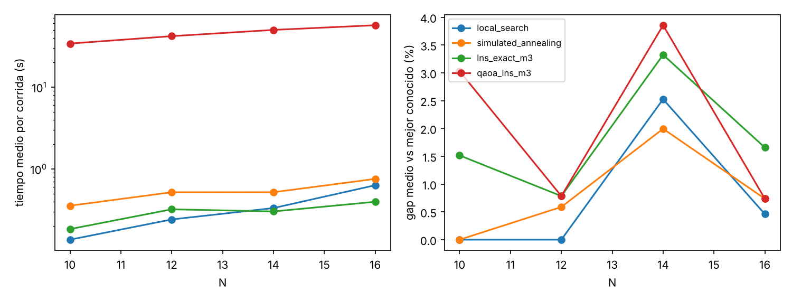

# Quantum Sumaq Kawsay — QAP10 con Qiskit

**NTT DATA – IBM Quantum Hackathon 2026 · Qiskit Fall Fest Perú · Reto 5.1 Industria**

Asignación cuadrática (QAP) de la instancia `qap10` de MIPLIB: comparación de métodos
clásicos con un enfoque cuántico-híbrido en Qiskit (QAOA sobre subproblemas + búsqueda de
gran vecindario). Óptimo de referencia: **C\* = 340**.

> Contexto elegido: **Track A · puertas de embarque** — 10 vuelos de conexión a 10 puertas.
> `F[i,k]` = pasajeros en tránsito entre los vuelos *i* y *k*; `D[j,l]` = distancia entre las puertas *j* y *l*.
> Los datos son un benchmark matemático: las unidades y conclusiones operativas son supuestos.

## Resultado en una línea

- Matrices F y D **reconstruidas desde el MPS** y verificadas: óptimos 24 (N=3), 32 (N=4) y **340** (N=10).
- **QAOA en Qiskit** (9 y 16 qubits) encuentra los óptimos 24 y 32; con p=2 y CVaR, el 30.5 % de los shots
  de N=3 son factibles (vs 1 % al azar) y el 11 % son el óptimo (≈33× sobre el azar).
- **QAOA-LNS** (subproblemas de 9 qubits + transferencia de parámetros) llega al **óptimo 340 en 6 de 10
  corridas** (gap medio 1.65 %), siempre con asignaciones válidas; QAOA resolvió el 100 % de sus
  30 000 subproblemas al óptimo exacto.
- Honestamente: a N=10 los métodos clásicos son más rápidos (búsqueda local: 9/10 en 0.13 s). El valor
  del enfoque es que el circuito no crece con N (siempre 9 qubits) — ver la prueba de escalado.

## Estructura

```
data/            qap10.mps.gz (MIPLIB) y las matrices reconstruidas qap10_F.csv / qap10_D.csv
src/qap/
  mps_reader.py  reconstrucción de F y D desde la linealización del MPS
  problem.py     costo, subinstancias, fuerza bruta por lotes, generador de instancias sintéticas
  classical.py   búsqueda local 2-swap multiarranque y recocido simulado
  qubo.py        QUBO con penalizaciones y conversión a Hamiltoniano de Ising (SparsePauliOp)
  qaoa.py        circuito QAOA (RZ/RZZ + mezclador RX), optimización CVaR, muestreo con shots
  hybrid.py      QAOA-LNS: subproblemas de 9 qubits + transferencia de parámetros
scripts/
  01_build_data.py   reconstruye F, D y verifica los óptimos 24 / 32 / 340
  02_stage1_small.py Etapa 1: N=3 y N=4 (clásico vs QAOA, barridos de p, λ y objetivo)
  03_stage2_n10.py   Etapa 2: N=10 (fuerza bruta, LS, SA, LNS exacto, QAOA-LNS)
  04_scaling.py      Etapa 3: escalado N=10..16 (o instancias oficiales vía --F/--D)
  05_plots.py        figuras en results/
results/         JSON con todas las métricas y figuras
```

## Cómo reproducir

```bash
python -m venv .venv && source .venv/bin/activate
pip install -r requirements.txt
python scripts/01_build_data.py      # ~5 s
python scripts/02_stage1_small.py    # ~10-20 min (N=4 = 16 qubits en statevector)
python scripts/03_stage2_n10.py      # ~10 min
python scripts/04_scaling.py         # ~10-20 min
python scripts/05_plots.py
```

Versiones usadas: Python 3.13, Qiskit 2.6.1, NumPy 2.5, SciPy 1.18. Todas las corridas tienen
semilla fija (ver cada script). Instancias oficiales de la final:
`python scripts/04_scaling.py --F F.csv --D D.csv --name qap14`.

## 1. Modelo y datos

**Función objetivo** (convención del archivo: cada par se cuenta una vez):

  C(p) = Σ_{i<k} F_ik · D_{p(i) p(k)},  p permutación (elemento i → ubicación p(i)).

**Reconstrucción desde el MPS.** El archivo linealiza el QAP: 100 variables `X` (x_ij, índice
10·i + j + 1), 4 050 variables `Y` que sustituyen a los productos x_ij·x_kl, 20 restricciones
de asignación (`NX01..NX20`) y 1 800 restricciones de enlace `C??A###`. Para cada `Y` se buscan las
dos `X` con las que comparte filas de enlace y se toma su coeficiente en la fila objetivo `NOBJ`.
La matriz de coeficientes {(i,k)} × {(j,l)} resulta de **rango 1** (2.º valor singular ≈ 1e-13),
es decir, exactamente F_ik·D_jl; se factoriza en enteros (error de reconstrucción 0).
D resulta ser la **distancia Manhattan en una cuadrícula** (estilo Nugent). La factorización
tiene una ambigüedad de escala (F·c, D/c) que no altera ningún costo.

**Verificación de escala:** costo con el tensor original del MPS = costo con F·D para
permutaciones aleatorias; óptimos por fuerza bruta: N=3 → **24**, N=4 → **32**, N=10 → **340**
(10! permutaciones evaluadas en lotes de 200 000, ~3 s, sin guardarlas en memoria).

**QUBO.** x_ij ∈ {0,1}, N² variables:

  H(x) = Σ_{i≠k} Σ_{j≠l} ½ F_ik D_jl x_ij x_kl + λ Σ_i (Σ_j x_ij − 1)² + λ Σ_j (Σ_i x_ij − 1)²

y con x = (1 − Z)/2 se obtiene el Hamiltoniano de Ising (`SparsePauliOp`). Se verificó que la
energía QUBO de toda permutación coincide con su costo y que el diagonal del Ising coincide con
el QUBO.

**Elección de λ.** λ = 1 + máx_a (Σ_b |2·C_ab| + |h_a|): ningún cambio de un solo bit desde una
asignación válida puede reducir la energía, de modo que el mínimo global del QUBO es siempre
factible. Para N=3 da λ = 49 y para N=4, λ = 133. Se probaron también 0.25λ y 0.5λ.

## 2. Qué hace Qiskit y qué es clásico

| Componente | Qiskit | Clásico |
|---|---|---|
| Hamiltoniano de Ising del QUBO | `SparsePauliOp` | — |
| Circuito QAOA (RZ, RZZ, RX parametrizados) | `QuantumCircuit`, `ParameterVector` | — |
| Simulación durante la optimización | `Statevector` | — |
| Muestreo final con shots | `StatevectorSampler` | — |
| Optimización de β, γ (objetivo CVaR₀.₁) | — | SciPy COBYLA |
| Decodificación, factibilidad y costo real | — | NumPy |
| Búsqueda de gran vecindario (LNS) | QAOA resuelve cada subproblema | selección de vecindarios, aceptación |

## 3. Resultados

### Etapa 1 — N = 3 (9 qubits) y N = 4 (16 qubits)

Clásico: fuerza bruta y búsqueda local encuentran 24 y 32 en milisegundos.
QAOA (objetivo CVaR₀.₁, 4096 shots, λ seguro, COBYLA). "Factible" = muestras que son una
permutación válida; "P(ópt)" = muestras que son exactamente el óptimo.

| N | Método | Qubits | Prof. / 2q | Factible | P(ópt) | Mejor costo |
|---|---|---|---|---|---|---|
| 3 | Muestreo aleatorio | 9 | — | 1.0 % | 0.34 % | 24 |
| 3 | QAOA p=1 | 9 | 18 / 36 | 11.7 % | 3.5 % | **24** |
| 3 | **QAOA p=2** | 9 | 29 / 72 | **30.5 %** | **11.1 %** | **24** |
| 3 | QAOA p=3 | 9 | 40 / 108 | 27.1 % | 9.4 % | **24** |
| 4 | Muestreo aleatorio | 16 | — | 0.07 % | 0 % | 44 |
| 4 | QAOA p=1 | 16 | 29 / 96 | 3.1 % | 0.34 % | **32** |
| 4 | QAOA p=2 | 16 | 47 / 192 | 3.5 % | 0.27 % | **32** |
| 4 | **QAOA p=3** | 16 | 65 / 288 | **5.5 %** | **0.54 %** | **32** |

Barridos (p=2): con λ reducido a 0.25λ la factibilidad cae (N=3: 30.5 % → 16.9 %;
N=4: 3.5 % → 1.9 %), y minimizar el valor esperado en lugar de CVaR también la reduce
(N=3: 14.7 %; N=4: 1.9 %). CVaR + λ seguro fue la mejor combinación.



### Etapa 2 — qap10 completo (N = 10, óptimo 340)

Un QUBO de 100 qubits no se puede simular (2¹⁰⁰ amplitudes ≈ 2·10³¹ B). Se diseñó
**QAOA-LNS**: en cada iteración se liberan 3 vuelos (elegidos por interacción) y sus 3 puertas;
el resto queda fijo y aporta un costo lineal. Ese subproblema (9 qubits) se resuelve con QAOA
en Qiskit, se acepta la mejor muestra factible si no empeora, y tras 25 iteraciones sin
mejora se perturba la mejor solución (búsqueda local iterada). **Todas las asignaciones que se
reportan son válidas**: no hay reparación posterior; si QAOA no devuelve ninguna muestra
factible se mantiene la asignación actual (ocurrió 0 veces).

**Transferencia de parámetros:** los ángulos (β, γ) se optimizan una sola vez sobre 6
subproblemas de entrenamiento (γ normalizado por el mayor coeficiente del Hamiltoniano) y se
reutilizan sin optimizar en todos los demás.

10 semillas, 3 000 iteraciones por corrida (mismas semillas de vecindario para LNS exacto y QAOA-LNS):

| Método | Tipo | Mejor | Media | Gap medio | Corridas en 340 | Tiempo / corrida |
|---|---|---|---|---|---|---|
| Fuerza bruta (10! perms.) | exacto | **340** | — | 0 % | — | 3.0 s |
| Búsqueda local 2-swap (50 arranques) | clásico | **340** | 341.8 | 0.53 % | 9/10 | 0.13 s |
| Recocido simulado (50k it.) | clásico | **340** | 344.2 | 1.24 % | 6/10 | 0.99 s |
| LNS con subproblemas exactos (control) | clásico | **340** | 342.0 | 0.59 % | 8/10 | 0.39 s |
| **QAOA-LNS, parámetros transferidos** | **híbrido (Qiskit)** | **340** | 345.6 | 1.65 % | **6/10** | 64 s |
| QAOA-LNS, QAOA optimizado en cada subproblema (150 it.) | híbrido | 372 | 377.0 | 10.9 % | 0/2 | 51 s |

Métricas del componente cuántico en QAOA-LNS (30 000 llamadas a QAOA):
- QAOA encontró el **óptimo exacto del subproblema en el 100 %** de las llamadas.
- Fracción de muestras factibles por subproblema: **23.6 %** (al azar sería 6/512 = 1.2 %).
- La transferencia de parámetros reduce el tiempo por subproblema de 0.34 s a 0.02 s (**≈16×**)
  y además mejora la factibilidad (23.6 % vs ~15.5 % optimizando cada vez, con 98.7–99.3 % de aciertos).



### Etapa 3 — Escalado (instancias sintéticas tipo qap10, N = 10…16)

Como las instancias ampliadas oficiales se entregan en la final, se generaron instancias con la
misma estructura (cuadrícula Manhattan + flujos enteros dispersos, `grid_instance`, semilla 0).
No se conoce su óptimo: el gap se mide contra la mejor solución hallada por cualquier método.
2 semillas por método; LNS con 150·N iteraciones. Valores: costo medio (gap medio).

| N | Permutaciones | Qubits QUBO completo | Mejor conocido | Búsqueda local | Recocido | LNS exacto | **QAOA-LNS** | t QAOA-LNS |
|---|---|---|---|---|---|---|---|---|
| 10 | 3.6e+06 | 100 | 264 | 264 (0.0 %) | 264 (0.0 %) | 268 (1.5 %) | 272 (3.0 %) | 34 s |
| 12 | 4.8e+08 | 144 | 510 | 510 (0.0 %) | 513 (0.6 %) | 514 (0.8 %) | 514 (0.8 %) | 42 s |
| 14 | 8.7e+10 | 196 | 752 | 771 (2.5 %) | 767 (2.0 %) | 777 (3.3 %) | 781 (3.9 %) | 50 s |
| 16 | 2.1e+13 | 256 | 1086 | 1091 (0.5 %) | 1094 (0.7 %) | 1104 (1.7 %) | 1094 (0.7 %) | 57 s |

- El circuito cuántico **no crece con N**: siempre 9 qubits (statevector de 8 KiB), frente a
  2^(N²) amplitudes para el QUBO completo (N=14: ≈1.6·10⁶⁰ B). La memoria del proceso se mantuvo
  en ~133 MiB para todos los N.
- El tiempo de QAOA-LNS crece linealmente con el número de subproblemas (34 s → 57 s de N=10 a N=16).
- En N=16, QAOA-LNS encontró la mejor solución conocida (1086, ningún otro método la alcanzó) e
  igualó al recocido simulado en costo medio; en N=10 y N=14 quedó por detrás de los métodos clásicos. Con 2 semillas las diferencias entre
  métodos híbridos y clásicos están dentro del ruido estadístico.
- Para las instancias oficiales de la final: `python scripts/04_scaling.py --F F.csv --D D.csv --name qapNN`.




## 4. Límites y lecciones

- **QAOA no supera al clásico en este tamaño.** Para N=10 la fuerza bruta tarda 3 s y la
  búsqueda local 0.13 s; QAOA-LNS llega al mismo óptimo pero es ~160× más lento por corrida,
  porque cada subproblema se simula en statevector. Su calidad depende de la estrategia LNS:
  como QAOA resolvió el 100 % de los subproblemas al óptimo, se comporta como el LNS exacto
  (la diferencia 8/10 vs 6/10 viene de cómo se rompen los empates en movimientos laterales).
- **La codificación one-hot es costosa.** De 2^(N²) bitstrings solo N! son válidas
  (N=4: 24 de 65 536). Las restricciones se imponen solo vía penalización, así que gran parte
  de las muestras es infactible; λ demasiado bajo empeora la factibilidad. Mezcladores que
  preservan permutaciones (XY / QAOA de operador alternante) o codificaciones binarias serían
  el siguiente paso.
- **Escala del simulador.** 16 qubits ya cuestan segundos por evaluación; 25 qubits (N=5)
  requieren 512 MiB por statevector. La descomposición mantiene el circuito en 9 qubits
  independientemente de N: lo que crece es el número de subproblemas.
- **Hardware real.** No se ejecutó en un QPU de IBM. Un circuito p=2 de 9 qubits tiene 72
  puertas de dos qubits sin enrutar; en hardware heavy-hex el enrutamiento y el ruido
  reducirían la fracción factible, por lo que la reparación/aceptación clásica seguiría siendo
  necesaria.
- **Datos.** qap10 es un benchmark matemático: el contexto de puertas de embarque es una
  interpretación; no se afirman ahorros operativos reales.
- **Tiempos de la Etapa 1** medidos con dos procesos en paralelo en una máquina de 2 núcleos:
  sirven para comparar órdenes de magnitud, no como benchmark preciso.


## Fuentes

- Instancia: MIPLIB 2017, `qap10` — https://miplib.zib.de/instance_details_qap10.html
- QAOA: Farhi, Goldstone, Gutmann (2014), arXiv:1411.4028.
- CVaR-QAOA: Barkoutsos et al., *Quantum* 4, 256 (2020).
- Qiskit: https://www.ibm.com/quantum/qiskit
